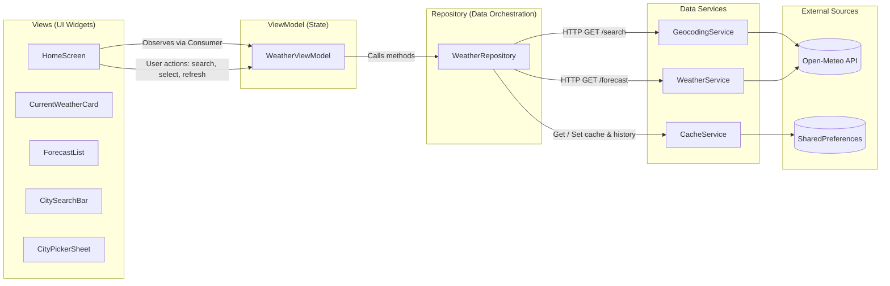

# 🌦️ Weather Forecast App (Flutter / Dart)

A clean, responsive, offline-first weather forecast application built for a **Mobile Developer Internship take-home assignment**. Built strictly following **MVVM architecture with Provider**, utilizing **Material 3**, and powered exclusively by the free [Open-Meteo](https://open-meteo.com/) APIs (no API keys required).

---

## 📸 Screenshots

| Light Mode (Empty & Search) | Light Mode (Weather & 5-Day) | Dark Mode | Multi-City Picker Bottom Sheet | Offline Banner Fallback |
| :---: | :---: | :---: | :---: | :---: |
| *(Placeholder)* | *(Placeholder)* | *(Placeholder)* | *(Placeholder)* | *(Placeholder)* |

---

## 🛠️ Technology Stack & Versions

- **Flutter SDK**: `3.47.9` (stable channel)
- **Dart SDK**: `3.13.7` (sound null-safety enabled)
- **Design System**: Material Design 3 (`useMaterial3: true`)
- **Third-Party Packages Used** (strictly adhering to the allowed list):
  - [`provider: ^6.1.5+1`](https://pub.dev/packages/provider): Dependency injection and MVVM state management via `ChangeNotifier`.
  - [`http: ^1.6.0`](https://pub.dev/packages/http): Clean, asynchronous HTTP networking with injectable clients for testability.
  - [`shared_preferences: ^2.5.6`](https://pub.dev/packages/shared_preferences): Persistent local key-value storage for offline caching, unit preferences, and search history.
  - [`connectivity_plus: ^7.3.2`](https://pub.dev/packages/connectivity_plus): Network connectivity detection.
  - [`intl: ^0.20.3`](https://pub.dev/packages/intl): Date formatting (e.g. `"Mon, 4 Nov"` and `"3 Nov, 12:30 PM"`).
- **Development & Testing Dependencies**:
  - `flutter_test`: Widget and unit testing framework.
  - [`mocktail: ^1.0.5`](https://pub.dev/packages/mocktail): Type-safe null-safe mocking without code generation.

---

## 🚀 Step-by-Step Setup and Run Instructions

### Prerequisites
- [Flutter SDK](https://docs.flutter.dev/get-started/install) (`>= 3.24.0` or `3.47.9` recommended)
- A connected physical device, Android Emulator, iOS Simulator, or desktop runner (Chrome/Windows/macOS/Linux).

### Running the App
1. **Clone the repository**:
   ```bash
   git clone <repo-url>
   cd weather_app
   ```

2. **Install project dependencies**:
   ```bash
   flutter pub get
   ```

3. **Verify static analysis and code quality**:
   ```bash
   flutter analyze
   ```
   *(Expected output: `No issues found!`)*

4. **Run the automated test suite**:
   ```bash
   flutter test
   ```
   *(Expected output: `All 36 tests passed!`)*

5. **Launch the application**:
   ```bash
   # Run on default connected device / emulator
   flutter run

   # Or run specifically on Chrome or Android:
   flutter run -d chrome
   flutter run -d android
   ```

---

## ✨ Features Completed

### Core Requirements
1. **City Search & Smart Input Validation**:
   - Trims all inputs.
   - Rejects empty, whitespace-only, or special-character-only inputs without calling the network.
   - Provides friendly inline validation feedback.
2. **Two-Step Disambiguation Flow**:
   - When searching for a city name shared across multiple states or nations (e.g. *"Springfield"* or *"London"*), a Material 3 bottom sheet surfaces up to 5 matching locations displaying city name, administrative region/state (`admin1`), and country.
   - If the geocoding service returns only 1 exact match, it is chosen immediately without unnecessary user friction.
3. **Current Weather Card**:
   - Displays city name, state/region, and country.
   - Large temperature readout with dynamic unit label (`°C` / `°F`).
   - WMO condition description and emoji weather icon.
   - Atmospheric humidity (`%`) and wind speed at 10m height (`km/h`).
4. **5-Day Weather Forecast**:
   - Formatted calendar dates (e.g., `"Mon, 4 Nov"`).
   - Daily predominant weather condition emoji and description.
   - Minimum and maximum temperatures (`min° / max°`).
5. **Loading & Empty States**:
   - Centered progress indicator with status text; UI never freezes during async operations.
   - Welcoming empty state on launch before any search is conducted.
6. **Robust Error Handling & Stale Request Protection**:
   - Catches every exception (`CityNotFoundException`, `NoInternetException`, `TimeoutException`, `ApiException`).
   - User-friendly error screens with an actionable **"Retry"** button.
   - **Request ID Counter**: Rapid successive searches ignore out-of-order, stale responses so only the latest query updates the screen.
7. **Offline Support & Cache Fallback**:
   - Every successful API response is cached in `SharedPreferences` as structured JSON with a timestamp.
   - When offline or when a request fails and a cache exists, the app gracefully falls back to saved data and displays an **Offline Warning Banner**:
     *"You're offline. Showing saved data from {time}, it may be outdated."*
   - If offline with no prior cache, an offline error screen with a Retry button is shown.
   - On app startup, cached weather is loaded instantly before attempting a background refresh.

### Bonus Features Implemented
- 🌡️ **Celsius / Fahrenheit Toggle**: Persisted across app restarts, re-queries Open-Meteo with `&temperature_unit=fahrenheit` when active.
- 🔄 **Pull-to-Refresh**: Seamless pull-to-refresh on the weather screen for instant updates of the active city.
- 🌓 **Automatic Dark Mode**: System-based theme switching between Material 3 Light and Dark color schemes.
- 🕒 **Persistent Search History**: Last 5 unique city searches saved locally and rendered as tappable filter chips directly beneath the search bar, with a one-tap clear option.
- 🧪 **Comprehensive Unit & Widget Tests**: 36 tests covering WMO code mapping, model JSON parsing, missing `"results"` key handling, and ViewModel states (success, city not found, offline-with-cache, unit toggle).

---

## 🏗️ Architecture: MVVM with Provider

The codebase follows the **Model-View-ViewModel (MVVM)** architectural pattern:



### Why MVVM with Provider?
1. **Simplicity and Maintainability for Interviews**:
   - Provider + `ChangeNotifier` is native to the Flutter ecosystem and requires no boilerplate or code generation (unlike BLoC or MobX). It is simple enough for an intern to explain top-to-bottom in an interview while remaining production-grade.
2. **Strict Separation of Concerns**:
   - **Views**: Pure UI widgets that reflect the current state. No HTTP calls or persistence logic exist in the widget tree.
   - **ViewModel**: Manages UI state, input validation, request debouncing/counter, and error mapping.
   - **Repository**: Single source of truth. Orchestrates network fetch, caching, and history.
   - **Services**: Low-level clients with direct responsibility (HTTP calls, JSON parsing, disk I/O).
3. **High Testability**:
   - By injecting dependencies (`http.Client`, `CacheService`, `WeatherRepository`) through constructors, every layer can be isolated and tested using standard `mocktail` mocks without live network requests.

---

## 📂 Project Directory Structure

```
lib/
├── core/
│   ├── constants/
│   │   ├── api_constants.dart      # Base URLs, paths, query params, 10s timeout
│   │   ├── app_constants.dart      # Cache keys, limits (5 history, 5 days)
│   │   └── app_strings.dart        # All user-facing UI and error copy
│   ├── errors/
│   │   └── app_exception.dart      # CityNotFoundException, NoInternetException, TimeoutException, ApiException
│   └── utils/
│       └── weather_code_mapper.dart # Translates WMO codes to description & emoji
├── data/
│   ├── models/
│   │   ├── city.dart               # Geographic location with name, country, admin1
│   │   ├── current_weather.dart    # Current temperature, humidity, wind, code
│   │   ├── daily_forecast.dart     # Daily min/max, condition, date
│   │   └── weather_data.dart       # Consolidated model with fromJson/toJson
│   ├── repositories/
│   │   └── weather_repository.dart # Geocoding -> Forecast -> Cache orchestration
│   └── services/
│       ├── cache_service.dart      # SharedPreferences cache & search history
│       ├── geocoding_service.dart  # Open-Meteo search API client (10s timeout)
│       └── weather_service.dart    # Open-Meteo forecast API client (10s timeout)
├── viewmodels/
│   └── weather_viewmodel.dart      # ChangeNotifier handling state & race conditions
├── views/
│   ├── home_screen.dart            # Main reactive screen
│   └── widgets/
│       ├── city_picker_sheet.dart  # Modal bottom sheet for duplicate cities
│       ├── current_weather_card.dart # Header card with current atmospheric metrics
│       ├── empty_view.dart         # Welcoming initial search prompt
│       ├── error_view.dart         # Error presentation with Retry action
│       ├── forecast_list.dart      # 5-day forecast card container
│       ├── forecast_tile.dart      # Single day forecast row entry
│       ├── loading_view.dart       # Asynchronous progress indicator
│       ├── offline_banner.dart     # Warning pill with cache timestamp
│       └── search_bar.dart         # Input field with clear & validation
└── main.dart                       # App entry point, DI, light/dark themes
```

---

## 🧭 Key Assumptions & Design Decisions

1. **Two-Step Geocoding Flow**:
   - If the geocoding API returns exactly 1 result, we automatically fetch weather for that city.
   - If it returns multiple results (e.g. *Springfield* in Illinois vs Oregon), we prompt the user with a bottom sheet showing `name, admin1, country` so they can pick their desired location.
2. **10-Second Request Timeout**:
   - All network calls specify `.timeout(Duration(seconds: 10))`. If the network hangs, a `TimeoutException` is thrown and mapped to a friendly message with a Retry button.
3. **Offline Strategy**:
   - Cache stores the complete serialized `WeatherData` JSON alongside an ISO8601 timestamp.
   - If a fetch fails due to connectivity or timeout, the app checks if any cached data exists. If found, it displays the data with the offline banner rather than locking the user on a blank error screen.
4. **Race Condition Prevention**:
   - An internal `_activeRequestId` counter ensures that if a user types or taps multiple searches quickly, any delayed response from an earlier request is discarded automatically.

---

## ⚠️ Known Limitations

1. **Current Location (GPS)**:
   - Excluded intentionally per assignment prompt instructions (`Skip the current-location feature`).
2. **Hourly Breakdown**:
   - The current scope focuses on current conditions + 5-day daily forecasts. Hourly granular forecasts are not displayed.
3. **Precipitation Probability**:
   - While humidity is included, precipitation percentage was omitted to keep the UI clean and uncluttered.

---

## 🔮 What I Would Improve With More Time

1. **Hourly Forecast Carousel**:
   - Add a horizontal scrollable 24-hour forecast carousel showing temperature trends throughout the day.
2. **Weekly Interactive Charts**:
   - Render a interactive line chart showing temperature fluctuations over the 5-day period using a lightweight custom painter.
3. **GPS / Current Location Support**:
   - Integrate `geolocator` to support a "Use My Current Location" button on first launch.
4. **Localization (i18n)**:
   - Expand `AppStrings` into `.arb` files with `flutter_localizations` supporting multi-language weather conditions.
5. **Precipitation & UV Index**:
   - Add UV index, air quality index (AQI), and precipitation probability cards.
